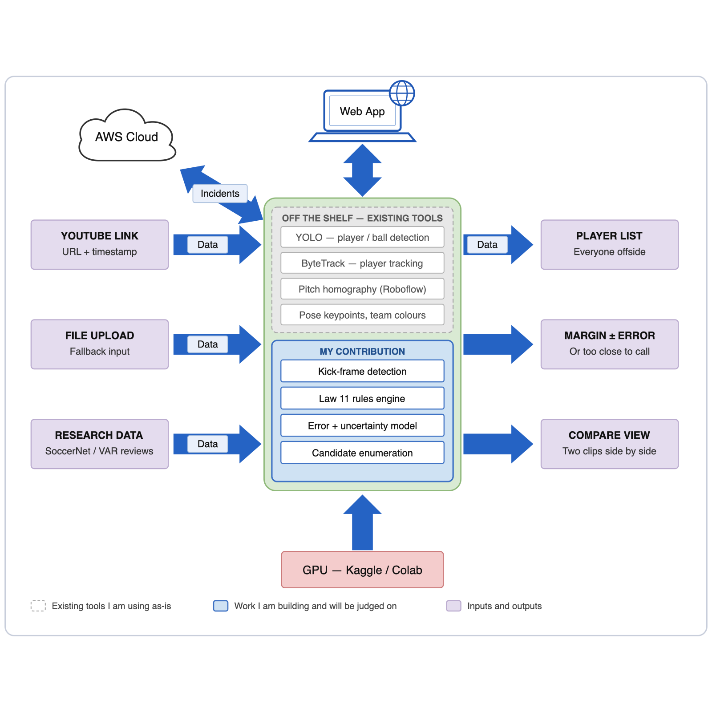

# A Computer-Vision Countermeasure to Attentional Bias in Video-Assisted Refereeing

**Project Engineering, Proposal — Year 4**
Daragh Kearney
Bachelor of Engineering (Honours) in Software and Electronic Engineering
Atlantic Technological University
2026/2027

> Set the title and author in Word via **File > Info > Properties** so the cover page and running
> headers update automatically.

---

## 1 Summary

I want to build a tool that takes a clip of an attacking move and tells a reviewer which offside
situations are worth a second look. It does not make decisions. Its job is to make sure that every
player who might matter to an offside call actually gets looked at.

### 1.1 What already exists, and what I am building

Football player tracking is a crowded field and most of the perception work is already solved and
freely downloadable. Pretending otherwise would be dishonest, so I want to be explicit about the
line. Everything in the left column I will install and use as-is. Everything in the right column is
mine, and is the work I expect to be judged on.

| Already available — I will use it as-is | What I am building |
|---|---|
| Player, ball and referee detection (YOLO with football-trained weights) | Finding the exact frame the ball is played, and measuring how much error that single choice introduces |
| Keeping player identities across frames (ByteTrack) | A Law 11 rules engine: second-last defender including the keeper, the level-with-the-ball exception, and an offside line set by the frontmost body part that can *legally* play the ball rather than the bottom of a bounding box |
| Assigning players to teams from kit colour | Listing **every** attacker in an offside position at the kick, instead of checking one nominated player |
| Pitch-marking detection and the transform to a top-down view (Roboflow `sports`) | An error model — how far out those off-the-shelf positions actually are, and how that changes with camera angle, crowding and occlusion |
| Pose keypoints (YOLO-pose) | Turning that error into a stated margin with an error bar, and a "too close to call" verdict when the margin falls inside it |
| Pretrained action-spotting baselines (SoccerNet); fetching a short window from a YouTube URL (`yt-dlp`) | The web application: paste a YouTube link (or upload a file), get the analysis back, compare two clips |
| | Testing against published independent reviews of real decisions, rather than against labels produced by the same officials whose misses I am looking for |

Put simply: *"where is every player on the pitch"* is a solved problem I am treating as an input.
*"Which of them mattered, by how much, and how confident can we honestly be"* is the project.

### 1.2 The deliverable

A web application. You paste a YouTube URL and a timestamp, or upload a file, and it returns:

1. the frame it decided the ball was played on;
2. every attacking player who was beyond the offside line at that instant;
3. for each one, how far beyond, with an error bar;
4. a verdict — onside, offside, or too close to call.

A **comparison view** shows two analyses side by side. The most revealing comparison is the same
incident with the kick frame shifted by one or two frames, because it shows how much the verdict
depends on something the footage cannot fully settle. That is also the clearest way to demonstrate
why this problem is harder than it looks.

The main way in is a **YouTube link**. You paste a URL and a rough timestamp, and the system
pulls down only that few seconds of video rather than the whole match, which keeps it quick and
cheap. File upload and the research dataset clips are the other two routes, and the dataset clips
are what I measure accuracy against. Clips fetched from a link are analysed and then deleted —
nothing is stored or republished, and it is only ever used for this project.

### 1.3 Where the difficulty is

**Finding the moment the ball is kicked.** Offside is judged at that instant. TV footage runs at
25 frames a second, so frames are 40 ms apart and a sprinting player moves about 30 cm between
them. Professional systems avoid this by putting a sensor in the ball; I have no such signal. This
sets a hard limit on how precise I can be, which is why the system needs to say "too close to
call" rather than guess.

**Knowing how wrong the positions are.** The off-the-shelf tools give me coordinates but no
indication of how accurate they are, and they get worse as the camera angle flattens, players
crowd together, or markings leave the shot. Measuring that properly and carrying it through to the
final verdict is the part that does not exist yet.

**Knowing whether I am right.** Public football datasets only label offsides that were *given*.
There is no dataset of offsides that were missed, which is exactly what I am looking for, so I have
to assemble my own test set from published reviews of contested decisions.

### 1.4 What success looks like

- **Must have:** a measured accuracy figure for the off-the-shelf positions; a tested Law 11
  engine that lists every offside-position attacker; margins reported with error bars and a
  "too close to call" verdict; a working web application that does all this on a YouTube link or
  an uploaded clip.
- **Should have:** the comparison view, and incidents delivered through AWS with the delay
  measured.
- **Nice to have:** telling apart a player standing offside from one actively going for the ball;
  a small study comparing what people notice in a clip against what the system flags.

I am not claiming the system will make better decisions than a VAR official — I could not prove
that. What I can show is that it never skips a player, and that it is honest about its own error.

---

## 2 Background

### 2.1 Why I chose this

The idea came from the winning goal in the 2026/27 Manchester derby, Manchester United 0–1
Manchester City. Erling Haaland scored, was flagged offside, and VAR overturned the flag after
finding he was onside by three centimetres. But his teammate Enzo Fernández had been clearly
offside and had dived at the same cross, interfering with United's defenders and goalkeeper
without touching the ball. Law 11 allows a player to be penalised for exactly that, so the goal
should have been disallowed.

Howard Webb later explained on *Match Officials Mic'd Up* that the VAR checked only whether
Fernández had touched the ball and never considered any other kind of involvement. He called it
"tunnel vision". The Premier League's independent review panel agreed unanimously that the goal
should not have stood.

What makes this worth building something around is that **it was not a measurement problem**.
The technology measured Haaland to within three centimetres. The failure was that a second
player was never looked at. Nobody asked the right question.

That also tells me what my tool can and cannot do. On the Haaland question, three centimetres is
far beyond what TV footage can resolve, and the honest answer is "too close to call". On the
Fernández question — a player clearly beyond the line diving at the ball — TV footage is more
than good enough. The incident that caused all the trouble is the easy case for my system.

### 2.2 Similar projects

Commercial offside technology uses installed camera arrays and a sensor in the ball, so it is the
accuracy benchmark but nothing I can compete with. Academic work on automated refereeing is
mostly SoccerNet's VARS research, which targets fouls rather than offside.

The closest comparators are the open-source offside detectors that combine YOLO with a
perspective transform. I went through several, and they share the same three gaps: they analyse
one nominated player instead of all of them, they draw a confident line with no sense of how
wrong it might be, and they are demonstrated on a handful of clips rather than measured against
ground truth. Those three gaps are the right column of the table in §1.1.

### 2.3 Data

Three sources, each for a different purpose:

- **SoccerNet** for ground-truth player positions, so I can measure how accurate the off-the-shelf
  perception really is and build the error model from real numbers.
- **Published reviews of contested decisions** — the Premier League's independent panel rulings
  and *Match Officials Mic'd Up* — as test cases, because they judge decisions independently of
  the officials who made them.
- **My own footage**, recorded on a local pitch with positions physically measured, which gives me
  exact ground truth for almost nothing.

Broadcast footage is copyrighted, so everything I train and measure against comes through
SoccerNet's research agreement or from my own camera. Clips pulled from a user-supplied link are
analysed and discarded rather than kept, and are not redistributed.

---

## 3 Architecture Diagram

**Figure 3-1: Architecture Diagram**

The dashed grey panel is the existing tooling I am installing and using unchanged. The blue panel
is the work I am building. The main input is a YouTube link plus a timestamp — the app pulls
only those few seconds, the grey layer turns them into tracked players and pitch coordinates,
and the blue layer decides which of those players mattered, by how much, and with what
confidence. File upload is the fallback. Results go out as a list of everyone offside, a margin
with an error bar, and a comparison view. AWS stores the incidents and serves them to the web
application, and the heavy processing runs on free hosted GPUs rather than locally.

The one design decision worth highlighting is the split inside the blue panel. Detection and
tracking are machine learning and are treated as such, with error figures attached. The offside
rules are ordinary code that can be read and tested line by line. No neural network is asked to
learn the offside rule.

---

## 4 Project Management

The module is about 275 hours. Note that P0 is deliberately short: assembling the existing tools is
a setup task, not the project. The bulk of the time goes into the right-hand column of §1.1.

| Phase | When | What I deliver | Hours |
|---|---|---|---|
| **P0** Setup | Oct 2026 | Data access and ethics applications in; repository and CI running; existing YOLO and homography tools assembled and working on one clip | ~30 |
| **P1** Measuring the baseline | Oct – Dec 2026 | How accurate the off-the-shelf positions actually are, measured against ground truth, and an error model describing how that varies | ~50 |
| **P2** Rules and uncertainty | Nov 2026 – Jan 2027 | Kick-frame detection; Law 11 rules engine with tests; margins with error bars and "too close to call" | ~70 |
| **P3** Involvement | Jan – Mar 2027 | Following each offside player after the kick and describing what they did | ~35 |
| **P4** Application | Jan – Mar 2027 | Web application taking a YouTube link or an upload; comparison view; AWS backend; CI/CD; performance testing | ~60 |
| **P5** Evaluation | Mar – Apr 2027 | Testing against all three data sources, observer study, dissertation, demo | ~30 |

**Basic goals** — I am confident of these, and together they make a complete project: a measured
accuracy figure and error model for the off-the-shelf perception; automatic kick-frame detection;
a tested Law 11 engine listing every offside-position attacker; margins reported with error bars
and a "too close to call" verdict; and a web application that runs all of it on a YouTube link or
an uploaded clip.

**Stretch goals**, in order: the comparison view; AWS deployment with live push and measured
delay; distinguishing a passive offside player from one actively going for the ball; authentication
and a security review; load testing; and the observer study.

Live TV integration and multi-camera analysis are out of scope — the first for licensing reasons,
the second because the data does not exist. Both go in future work.

The biggest risk is SoccerNet data access being slow or refused, so I am applying in week one and
have openly licensed datasets and my own footage as a fallback. The observer study needs ethics
approval, which is also applied for early.

**Tools.** GitHub for the repository, issues and CI. GitHub Projects for the board. OneNote for a
weekly logbook recording hours, decisions, experiments, supervisor meetings and where I used and
rejected AI tool output. I am treating the logbook as a deliverable, since it is the only record of
how I got to the result.

---

## 5 Software

- **Existing tools (used as-is):** Ultralytics YOLO for detection and pose, ByteTrack for tracking,
  Roboflow's `sports` library for pitch keypoints and the top-down transform, OpenCV for video
  handling, `yt-dlp` and ffmpeg for pulling a short window out of a linked video.
- **My pipeline:** Python and NumPy for the kick-frame detection, the error model and the
  uncertainty maths.
- **Rules engine:** Python, kept as a separate package with no dependency on the vision code so
  it can be tested exhaustively on its own.
- **Backend:** Python on AWS Lambda, with API Gateway, DynamoDB for incident records and S3
  for clips. Serverless only, so it stays within student credits.
- **Front end:** React and TypeScript with Vite and Tailwind.
- **Testing:** pytest for Python, Vitest and Playwright for the front end, with GitHub Actions
  running linting, type checking and tests on every push.
- **GPU:** Kaggle notebooks (around 30 GPU-hours a week) with Google Colab as backup. No GPU
  work runs on AWS because of the cost.

---

## 6 Hardware

No custom electronics — this is a software project, so the engineering depth is in the
architecture, testing and evaluation instead.

- **Laptop** — *[insert specification: CPU, RAM, storage, GPU if any]*. 16 GB RAM minimum for
  working with video. No discrete GPU, which is why the hosted GPU plan above is part of the
  design rather than a fallback.
- **1 TB external SSD** for video. Research football footage runs to hundreds of gigabytes.
- **Action camera or phone and a tripod**, plus a measuring tape, for recording a few staged
  scenarios on a local pitch with the positions actually measured. This is the cheapest accurate
  test data available to me.
